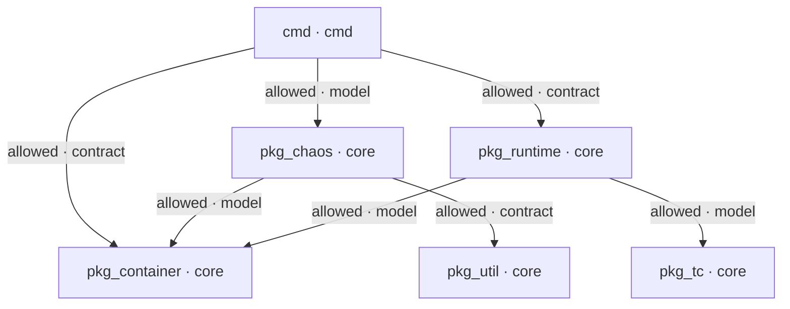

# Architecture policy

Pumba checks its module boundaries on every pull request with
[archfit](https://github.com/alexei-led/archfit). The policy lives in
[`.archfit.yaml`](../.archfit.yaml). The approved architecture is the module
graph below. A pull request that changes it fails the architecture check.

## Modules

| Module          | Paths            | Layer | What it owns                                                     |
| --------------- | ---------------- | ----- | ---------------------------------------------------------------- |
| `cmd`           | `cmd/`           | cmd   | CLI entry point; wires the runtime and the chaos commands         |
| `pkg_chaos`     | `pkg/chaos/`     | core  | Chaos actions (netem, iptables, lifecycle, stress) and their CLI  |
| `pkg_container` | `pkg/container/` | core  | Container model and the `container.Client` interfaces             |
| `pkg_runtime`   | `pkg/runtime/`   | core  | Docker, containerd and Podman adapters for `container.Client`     |
| `pkg_tc`        | `pkg/tc/`        | core  | `tc` command builder                                              |
| `pkg_util`      | `pkg/util/`      | core  | Domain-agnostic parsing helpers                                   |

## Approved dependencies

Each arrow is an allowed cross-module dependency. Every other one is denied.
The label is the integration strength archfit measures on that edge.



Generated by `archfit map -c .archfit.yaml`. Regenerate it after a policy change.

Two boundaries carry the design:

- Chaos actions reach a runtime only through `container.Client`. `pkg/chaos`
  never imports `pkg/runtime`, so every action works on Docker, containerd and
  Podman.
- `pkg/container`, `pkg/tc` and `pkg/util` depend on no other module.

## What the check blocks

| Rule                    | Blocks                                                     |
| ----------------------- | ---------------------------------------------------------- |
| `approved-module-graph` | A cross-module dependency not listed in `depends_on`       |
| `no-module-cycles`      | A dependency cycle between modules                         |
| `no-chaos-to-runtime`   | `pkg/chaos` importing a runtime adapter                    |
| `no-container-to-chaos` | `pkg/container` importing chaos behavior                   |
| `no-util-to-domain`     | `pkg/util` importing chaos behavior                        |
| `layer-inversion`       | A core package importing `cmd`                             |

The coupling gate also fails on a new distributed-monolith seam, and new
production code outside every module makes the result `unknown`.

## Check a change locally

```sh
archfit policy can-import pkg/chaos/netem/netem.go pkg/runtime/docker
archfit check --format agent
```

`change.status: pass` means the change keeps the approved architecture. Exit
code `2` with `pass` is fine: it reports repository-level evidence gaps, such
as no supplied test coverage.

## Change the architecture

The architecture can change, but not as a side effect of a code change.

1. Open a pull request that edits `.archfit.yaml` only: add the edge to
   `depends_on`, or change a module.
2. The architecture owner approves that exact commit.
3. Land the code change after the policy change merges.

Removing an edge from `depends_on` tightens the policy. Adding one loosens it.
Contributors and coding agents must not edit `.archfit.yaml`,
`.archfit-baseline.json` or `.archfit-labels.yaml` to make a check pass.

## Pull request feedback

The Archfit GitHub App runs the check in this repository's CI through
`.github/workflows/archfit.yaml`. Source code never leaves GitHub Actions. The
App posts the result on the pull request as the `archfit/gate` check, which
`master` requires. Pull requests from forks get a `fork_unsupported` result; a
maintainer pushes the branch to this repository to run the check, or merges
with the ruleset bypass.
