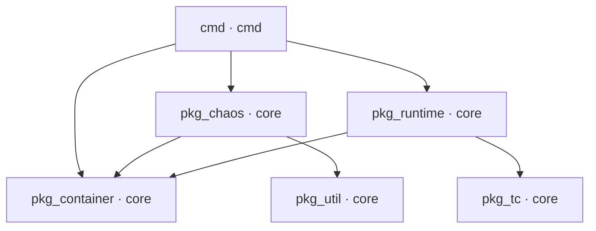

# Architecture policy

Pumba checks its module boundaries on every pull request with
[archfit](https://github.com/alexei-led/archfit). The policy lives in
[`.archfit.yaml`](../.archfit.yaml): the modules, the dependencies each module
may have, the rules, and the exceptions. A change that adds an error fails the
check.

## Modules

| Module          | Paths            | Public                                               | Layer | Volatility | What it owns                                                                           |
| --------------- | ---------------- | ---------------------------------------------------- | ----- | ---------- | -------------------------------------------------------------------------------------- |
| `cmd`           | `cmd/`           | `cmd`                                                | cmd   | low        | CLI entry point; wires the runtime and the chaos commands                              |
| `pkg_chaos`     | `pkg/chaos/`     | `pkg/chaos`, `pkg/chaos/cliflags`, `pkg/chaos/*/cmd` | core  | high       | Chaos actions (netem, iptables, lifecycle, stress) and their CLI                       |
| `pkg_container` | `pkg/container/` | `pkg/container`                                      | core  | medium     | Container model and the `container.Client` interfaces                                  |
| `pkg_runtime`   | `pkg/runtime/`   | `pkg/runtime/*`                                      | core  | high       | Docker, containerd and Podman adapters for `container.Client`                          |
| `pkg_tc`        | `pkg/tc/`        | `pkg/tc`                                             | core  | high       | `tc` and `iptables` commands Pumba runs in a target netns, and parsing of their output |
| `pkg_util`      | `pkg/util/`      | `pkg/util`                                           | core  | low        | Domain-agnostic parsing helpers                                                        |

The public part of a module is what other modules may use. Test files
(`*_test.go` files and any `tests/` directory) and the generated mocks are
outside the rules.

## Allowed dependencies

Each arrow is an allowed dependency (`depends_on`). Any other dependency
between modules is an error. `archfit rules --graph` prints the same graph from
the policy.



Three boundaries carry the design:

- Chaos actions reach a runtime only through `container.Client`. `pkg/chaos`
  never imports `pkg/runtime`, so every action works on Docker, containerd and
  Podman.
- `pkg/container`, `pkg/tc` and `pkg/util` depend on no other module.
- Only `cmd` depends on `pkg_runtime`: it is the one place that picks a runtime.

## Rules

Built-in rules apply to what a change adds:

| Rule          | What it says                                                                                                                     |
| ------------- | -------------------------------------------------------------------------------------------------------------------------------- |
| `graph`       | A dependency between two modules must be an allowed dependency. An owner may approve a new one.                                  |
| `coupling`    | A module uses the public part of a module it may depend on. It reaches past the public part only into a `low` volatility module. |
| `duplication` | Knowledge that another module owns is not copied, such as the interface-name rule in `pkg/util`. An owner may approve a copy.    |
| `cycle`       | No new cycle between modules.                                                                                                    |
| `layers`      | `core` modules never depend on `cmd`.                                                                                            |
| `unowned`     | New production code belongs to a module.                                                                                         |

Custom rules of this policy:

| Rule                    | Forbids                       |
| ----------------------- | ----------------------------- |
| `no-chaos-to-runtime`   | `pkg_chaos` → `pkg_runtime`   |
| `no-container-to-chaos` | `pkg_container` → `pkg_chaos` |
| `no-util-to-domain`     | `pkg_util` → `pkg_chaos`      |

`archfit rules <rule>` prints a rule in full: why it exists and what to do
instead.

Four `duplication` exceptions permit copies that existed when the policy was
converted to Archfit 4: between `cmd` and `pkg_chaos`, `cmd` and `pkg_runtime`,
`pkg_chaos` and `pkg_runtime`, and `pkg_container` and `pkg_runtime`. An
exception covers every copy between its two modules. `archfit rules duplication`
lists them.

## Check a change locally

```sh
archfit rules                 # the rules for the files you change
archfit can pkg/tc pkg/util   # before a new dependency between modules
archfit check                 # before you finish
```

`archfit check` compares the working tree with its merge base on `master`. It
prints one record per error, with why and what to do next, and ends with the
status: `archfit: pass` (exit 0), `archfit: fail` (exit 1), or
`archfit: unknown` (exit 2: no verdict, and the record says what is missing).

## Change the policy

The policy can change, but not as a side effect of a code change. Workers ask;
they never edit `.archfit.yaml`, and they never copy code to get around a rule.

1. When a rule is in your way, run `archfit request -m "<why>"`. The request is
   a GitHub issue with the errors of the last check.
2. An owner approves or rejects it in the Archfit App. An approval becomes a
   pull request from the App that changes `.archfit.yaml`. A rejection becomes
   a `deny` rule with `instead`, so the next worker gets the answer.
3. The check runs again on your pull request.

A pull request that changes `.archfit.yaml` and is not the App's pull request
is `unknown`.

## Pull request feedback

The Archfit GitHub App runs the check in this repository's CI through
`.github/workflows/archfit.yaml`. Source code never leaves GitHub Actions. The
App posts the result on the pull request as the `archfit/gate` check, which
`master` requires. On a pull request the status can also be `waiting`: an open
request covers the errors. Pull requests from forks are not supported by the
required check; the record says what to do.
